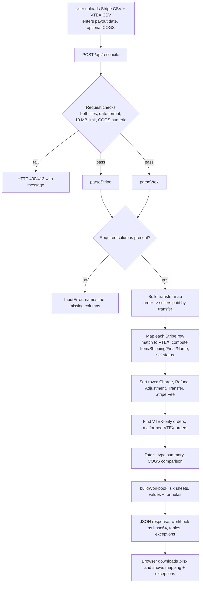
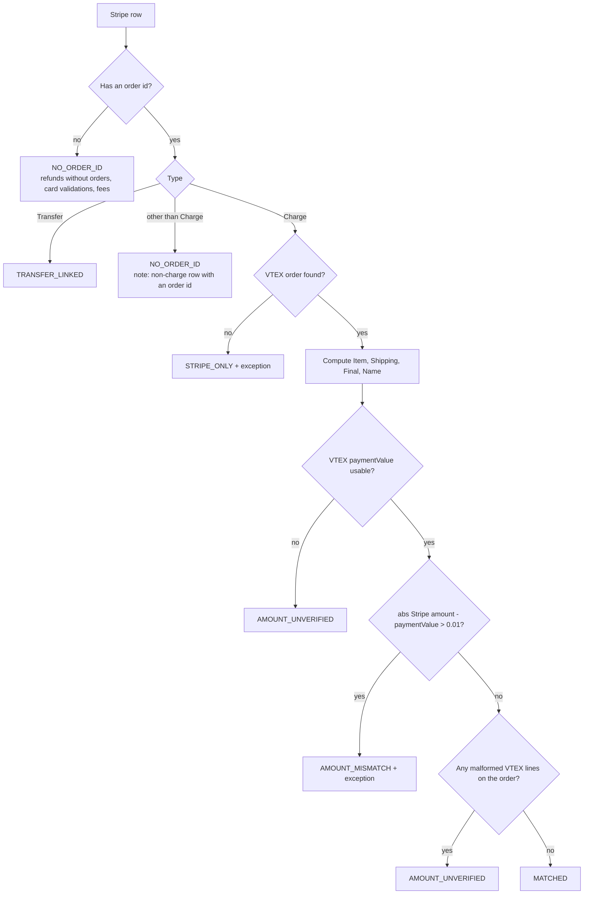

# Stripe Payout Reconciliation: How the System Works

This guide describes what the system does from the moment you upload two CSV files to the moment you download the payout workbook. It covers every step, every calculation, every sheet in the output, and every rule that can send a row to the Exceptions list.

All figures in worked examples come from the sample files in `tests/fixtures/` (`Stripe Test.csv` and `VTEX Test.csv`), with the payout date 10 November 2026.

---

## Contents

1. [What the system does](#1-what-the-system-does)
2. [Project layout](#2-project-layout)
3. [End-to-end flow](#3-end-to-end-flow)
4. [Inputs](#4-inputs)
5. [Step-by-step processing](#5-step-by-step-processing)
6. [Calculation reference](#6-calculation-reference)
7. [Match statuses and exceptions](#7-match-statuses-and-exceptions)
8. [Output workbook, sheet by sheet](#8-output-workbook-sheet-by-sheet)
9. [Web layer: screen and API](#9-web-layer-screen-and-api)
10. [Sample run results](#10-sample-run-results)
11. [Assumptions, limitations and open questions](#11-assumptions-limitations-and-open-questions)
12. [How to change things](#12-how-to-change-things)
13. [Testing](#13-testing)
14. [Glossary](#14-glossary)

---

## 1. What the system does

A Stripe balance export lists every money movement in a payout: customer charges, refunds, transfers to marketplace sellers, and Stripe's own fees. A VTEX export lists the orders behind those charges, one row per product line.

The system joins the two on the **order id**, works out for each charge how much belongs to this business (and under which business name), and writes the result as a finance-ready workbook that reproduces the layout of the manual file `Stripe Payout 10th Nov 26 $37912.23.xls`.

Inputs: a Stripe CSV, a VTEX CSV, a payout date, and optionally a COGS figure.
Output: one `.xlsx` workbook with six sheets, plus an on-screen summary.

Nothing is stored. Files are read into memory, processed, and discarded when the request ends.

---

## 2. Project layout

```
recon-poc/
  core/                       Pure TypeScript. No web framework imports.
    types.ts                  Shared types. All money is integer cents.
    util.ts                   Money, date and label helpers
    parseStripe.ts            Stripe CSV -> StripeRow[]
    parseVtex.ts              VTEX CSV -> orders grouped by seller
    businessMappings.ts       Seller -> business Name lookup, GST rate
    reconcile.ts              Matching, Item/Shipping/Final, totals, exceptions
    exportXlsx.ts             Builds the six-sheet workbook
  app/
    page.tsx                  Upload screen and result tables
    api/reconcile/route.ts    POST endpoint
  tests/
    reconcile.test.ts         13 tests against the sample files
    fixtures/                 Sample CSVs and reference.json (values read from the manual file)
  docs/HOW_IT_WORKS.md        This document
```

The split matters. Everything that decides a number lives in `core/`. The web layer only collects input and shows output, so the same logic can later run from a command line, a scheduled job, or another interface.

---

## 3. End-to-end flow



In words:

1. The browser sends both files and the form fields to `/api/reconcile`.
2. The server checks the request. Bad requests stop here with a plain-language message.
3. Both files are parsed. Each parser checks the header row first, so a wrong file fails immediately.
4. The system notes which sellers were paid by Stripe transfer on which order.
5. Each Stripe row is matched to its VTEX order and given Name, Item, Shipping, Final and a match status.
6. Rows are ordered, totals are computed, and exceptions are collected.
7. The workbook is built and returned. The browser downloads it and shows the tables.

---

## 4. Inputs

### 4.1 Stripe CSV (balance report)

Required columns (the file is rejected if any are missing):

| Column | Used for |
|---|---|
| `Type` | Row category: `Charge`, `Refund`, `Transfer`, `Stripe Fee`, others |
| `ID` | Stripe id, shown in Transaction Details and Order Mapping |
| `Created` | Date and time, format `dd-MM-yyyy HH:mm` (for example `06-11-2026 13:40`) |
| `Description` | Source of the order id and, for transfers, the seller |
| `Amount`, `Fees`, `Net` | Money columns |

Optional columns that are read when present: `Currency` (lower-cased), `Customer Name`.

Typical descriptions:

| Row type | Description example |
|---|---|
| Charge | `Order:1674300537736` |
| Refund | `Invoice CLE6J7JH-0001`, `Card Validation - Order : 1FCCF1DA...` |
| Transfer | `Seller: twofold, Order: 1674420537737` |
| Stripe Fee | `Radar (2026-11-08): Standard` |

### 4.2 VTEX CSV (order export)

One row per product line. The file has 91 columns; the system uses these:

| Column | Used for |
|---|---|
| `Order` | Order id, for example `1674460537743-01`. The `-01` suffix is removed. |
| `Client Name`, `Client Last Name` | Customer name shown in Order Mapping |
| `Status` | Order status (shown, not used for matching) |
| `Payment System Name` | Card brand (kept on the order, reserved for MVP insights) |
| `Payment Value` | Total paid for the whole order. Same on every line of an order. |
| `Seller Name` | Marketplace seller. Blank means the business's own items. |
| `SKU Total Price` | Line value before shipping and GST. Basis of `Item`. |
| `Shipping Value` | Line shipping. Basis of `Shipping`. |
| `Total Value` | Required column, checked for being numeric. Not used in calculations. |

The other columns (address, UTM fields, tracking number, and so on) are ignored.

The VTEX header contains three empty-named columns. The CSV parser prints a harmless "Duplicate headers found and renamed" notice for them.

### 4.3 Form fields

| Field | Required | Notes |
|---|---|---|
| Payout date | Yes | Chosen by the user. Used in the sheet title and file name. The Stripe export has no payout id, and transaction dates (6 to 9 November) do not give the payout date (10 November). |
| COGS inc GST | No | Accounting figure. If left blank the system suggests the transfers total rounded to whole dollars. |

---

## 5. Step-by-step processing

### 5.1 Request checks (`app/api/reconcile/route.ts`)

| Check | Failure |
|---|---|
| Body is multipart form data | 400 "Request must be multipart form data." |
| Both `stripe` and `vtex` are files | 400 "Upload both the Stripe CSV and the VTEX CSV." |
| `payoutDate` is `yyyy-mm-dd` and a real date | 400 "Enter a valid payout date." |
| Each file is 10 MB or smaller | 413 "Each file must be 10 MB or smaller." |
| COGS, when given, is a plain non-negative number (commas allowed) | 400 "COGS must be a positive number, for example 5349.00." |

### 5.2 Parsing the Stripe file (`core/parseStripe.ts`)

1. A leading byte-order mark is removed.
2. The header row is checked against the required columns. Missing columns produce one error that lists all of them.
3. For each row:
   - **Date**: `dd-MM-yyyy HH:mm` is parsed strictly. `31-02-2026 10:00` is rejected, not rolled over to March. The date parts are stored as UTC so Excel displays exactly what Stripe exported, with no time-zone shift.
   - **Amount, Fees, Net**: converted to integer cents (see 6.1). A blank `Fees` counts as 0.
   - A row with an unreadable date or amount is skipped and reported as an error.
4. **Order id** is extracted from `Description` with:

   ```
   /Order\s*:\s*(\d{10,})(?![0-9A-Za-z])/i
   ```

   The id must be 10 or more digits and must not be followed by another letter or digit. This is deliberate. `Card Validation - Order : 1FCCF1DA098F...` starts with a digit, but the next character is a letter, so it is not treated as an order.
5. **Seller** (transfers only) is extracted with `/Seller\s*:\s*([^,]+)/i` and lower-cased, so `Seller: twofold, Order: 1674420537737` gives seller `twofold` and order `1674420537737`.

### 5.3 Parsing the VTEX file (`core/parseVtex.ts`)

1. The file is read with every field as text. This prevents long numbers (order ids, tracking numbers) from being turned into floating-point values.
2. The header row is checked against the required columns.
3. For each row:
   - **Order id** is normalised by removing a trailing `-<digits>` (`1674460537743-01` becomes `1674460537743`). A row with no order id is recorded as malformed.
   - **Usability test**: `SKU Total Price`, `Payment Value` and `Total Value` must be clean decimal numbers, and `Shipping Value` must be a clean decimal number or blank (treated as 0). If any fails, the line is **malformed**: it is counted against its order and left out of all calculations.
4. Usable lines are grouped by order, then by seller:

   ```
   order
     seller "" (own items)  -> item = sum of SKU Total Price, shipping = sum of Shipping Value
     seller "cottonon"      -> ...
     seller "twofold"       -> ...
   ```

5. The order also keeps `paymentValue` (from the usable lines), customer name, status and payment system.

**Why the usability test exists.** The sample VTEX file contains rows where values sit in the wrong columns. For order `1674710537752` the `SKU Total Price` column holds `4761` and the `Payment Value` column holds the text `34010736-PALAS JEWELLERY`. Other orders (`…769`, `…771`) have rows that are entirely blank. Using such rows would produce wrong money figures without any warning, so they are excluded and reported.

### 5.4 Building the transfer map (`core/reconcile.ts`)

For every Stripe row of type `Transfer` that has both an order id and a seller, the system records `order -> set of sellers`.

Meaning: a Stripe transfer to a seller on an order means that seller's goods were paid for out of this charge and passed to the seller. Those goods are not this entity's revenue, so they are excluded from `Item`.

Example, order `1674420537737`: transfer `Seller: twofold` of -414.49. The VTEX order has two sellers, `twofold` and `novoshoes`. Twofold is excluded. Novoshoes remains.

### 5.5 Mapping each Stripe row

Each row is processed by the decision tree below (`mapRow`).



**Item, Shipping, Final and Name** (charges with a VTEX order only):

1. `excluded` = sellers with a Stripe transfer on this order (empty if none).
2. `included` = the order's seller groups whose seller is not in `excluded`.
3. If `included` is not empty:
   - `Item` = sum of `item` over `included`.
   - `Shipping` = sum of `shipping` over `included`.
   - `Final` = `(Item + Shipping) × 1.10`, rounded to the nearest cent.
   - **Override**: if `excluded` is empty and `Final` is within 0.01 of the Stripe `Amount`, `Final` is set to the Stripe `Amount`.
   - `Name` = the business name for each included seller, looked up in `businessMappings.ts`. A seller with no mapping gives an `UNMAPPED_SELLER` exception. Different sellers that map to the same name (`cottonon` and blank both map to CERES) collapse to one name. If more than one distinct name results, they are joined with ` + ` and a `MULTIPLE_NAMES` exception is added.
4. If `included` is empty but the order has usable lines, every seller was paid by transfer. Item, Shipping, Final and Name stay blank, with the note "All sellers on this order are paid by transfer".
5. If the order has no usable lines at all, nothing can be computed. All four stay blank.

`variance` = Stripe amount minus VTEX `Payment Value`, in cents. Positive means Stripe collected more than VTEX recorded.

### 5.6 Ordering

Rows are sorted by type group, then by their original line number in the Stripe file:

```
Charge, Refund, Adjustment, Transfer, Stripe Fee, any other type
```

This reproduces the reference layout (charges first, then refunds, transfers and fees).

### 5.7 Whole-file checks

| Check | Result |
|---|---|
| More than one currency in the Stripe file | `MIXED_CURRENCY` exception |
| Two or more charges for the same order | `DUPLICATE_STRIPE_CHARGE` exception |
| VTEX order with no Stripe row at all | `VTEX_ONLY` exception and a row in Order Mapping |
| VTEX order with unusable lines | One `MALFORMED_VTEX_ROW` exception per order, with the count and the first data row |
| Stripe type outside the five known types | `UNKNOWN_STRIPE_TYPE` exception; the type gets its own summary line so totals still add up |
| COGS differs from transfers total | `COGS_VS_TRANSFERS` exception |

### 5.8 Totals and type summary

- **Totals**: sum of `Amount`, `Fees` and `Net` over all Stripe rows.
- **Type summary**: for each of Charge, Refund, Adjustment, Transfer, Stripe Fee (and any extra type), the count and the sums of Amount, Fees and Net.
- **Payout** = sum of Net over all types. It equals the Net total, and the workbook checks this.

### 5.9 COGS handling

COGS (cost of goods sold) and Stripe transfers are kept as separate concepts.

- `transfersTotal` = absolute value of the Net total for type Transfer.
- If the user entered COGS, that value is used.
- Otherwise COGS is suggested as `round(transfersTotal / 100) × 100` cents, which is the transfers total rounded to whole dollars, and the screen labels it "suggested from transfers".
- `cogsDifference` = COGS minus transfers total. A non-zero value adds a `COGS_VS_TRANSFERS` exception.

### 5.10 Title and file name

With payout date `2026-11-10` and Net 37,912.23:

| Item | Value |
|---|---|
| Date label | `10th Nov 26` (ordinal suffix: 1st, 2nd, 3rd, 4th, ... 11th, 12th, 13th, 21st) |
| Sheet title (cell A2) | `Stripe Payout 10th Nov 26 37912.23` |
| File name | `Stripe Payout 10th Nov 26 $37912.23.xlsx` |

---

## 6. Calculation reference

### 6.1 Money handling

All amounts are integer cents inside the system. `2394.95` becomes `239495`. This avoids floating-point drift (for example `0.1 + 0.2`) in totals that must agree with a bank figure to the cent.

Parsing rule: the text must match `-?digits[.digits]`. Anything else (text, `/1/27/31/`, blank) is not a number. The first two decimals are kept. If there is a third decimal of 5 or more, the value is rounded up by one cent (`1.005` becomes `101`).

Amounts are converted back to dollars only when written to Excel (`cents / 100`) or displayed.

### 6.2 Per-order formulas

Let `I` be Item and `S` be Shipping, both in cents, summed over the included sellers.

```
Final = round( (I + S) × 110 / 100 )          GST rate 10%, rounded half up
Final = Stripe Amount                         when no seller is excluded and |Final - Amount| <= 1 cent
Variance = Stripe Amount - VTEX Payment Value
Match = |Variance| <= 1 cent
```

The GST rate is `GST_RATE_PERCENT = 10` in `core/businessMappings.ts`.

#### Worked example A: ordinary own-items order (CERES)

Order `1674300537736`, no transfers, one seller group (blank seller):

| Quantity | Value |
|---|---|
| Item (sum of SKU Total Price) | 2,127.01 |
| Shipping | 50.22 |
| Item + Shipping | 2,177.23 |
| × 1.10 | 2,394.953 |
| Final (rounded) | 2,394.95 |
| Stripe Amount | 2,394.95 |
| VTEX Payment Value | 2,394.95 |
| Variance | 0.00 |
| Status | MATCHED, Name CERES |

#### Worked example B: the override rule

Order `1674450537740`:

| Quantity | Value |
|---|---|
| Item | 777.10 |
| Shipping | 35.15 |
| Item + Shipping | 812.25 |
| × 1.10 | 893.475 |
| Computed Final (rounds up) | 893.48 |
| Stripe Amount | 893.47 |
| Difference | 0.01, so within tolerance |
| Final used | 893.47 (the Stripe amount) |

The reference file shows 893.47. The charge actually collected is the authoritative figure, and this removes the half-cent rounding difference.

#### Worked example C: a multi-seller order with a transfer

Order `1674420537737`:

| Seller group | Item | Shipping | Treatment |
|---|---|---|---|
| twofold | 471.01 | 51.66 | Excluded: Stripe transfer of -414.49 on this order |
| novoshoes | 860.76 | 56.43 | Included |

| Quantity | Value |
|---|---|
| Item | 860.76 |
| Shipping | 56.43 |
| Item + Shipping | 917.19 |
| × 1.10 | 1,008.909 |
| Final | 1,008.91 |
| Stripe Amount | 1,583.85 |
| Name | INC NOVO |

Final (1,008.91) is not the Stripe amount here, because part of the charge belongs to twofold. The override does not apply since a seller was excluded.

The difference 1,583.85 - 1,008.91 = 574.94 is twofold's share including GST (522.67 × 1.10). The transfer of 414.49 is a different number because it is what Stripe actually sent to the seller. The system does not try to reconcile those two figures.

#### Worked example D: an order that is all marketplace

Order `1674720537753`: one seller group, `etikette` (437.31), with a transfer to etikette. Everything is excluded, so Item, Shipping, Final and Name stay blank. The row is still `MATCHED` on amount.

#### Worked example E: a malformed order

Order `1674710537752` (PALAS): all VTEX lines have shifted columns. No usable lines, so `paymentValue` is unknown. Status `AMOUNT_UNVERIFIED`, Item/Shipping/Final/Name blank, and a `MALFORMED_VTEX_ROW` exception lists the line count.

### 6.3 Workbook totals

On the Reconciliation sheet (rows 4 to 55 hold the 52 Stripe rows, row 56 is the totals row):

```
C56 = SUM(C4:C55)      Amount total   38,474.76
D56 = SUM(D4:D55)      Fees total        562.53
E56 = SUM(E4:E55)      Net total      37,912.23   <- the payout
```

### 6.4 GST and journal block

The block sits four rows below the totals row. In the sample (totals row 56) it occupies rows 60 to 65. Cells keep the same relationships as the reference sheet.

| Cell | Label | Formula | Sample value |
|---|---|---|---|
| G61 | COGS inc GST (code 310) | `='Accounting Summary'!B3` (the COGS input) | 5,349.00 |
| G60 | Sales Inc GST (code 200) | `=C56+G61` | 43,823.76 |
| G62 | Stripe Fee inc GST (code 405) | `=-D56` | -562.53 |
| G63 | bank | `=G60-G61+G62` | 37,912.23 |
| G64 | Gst | `=G63/110*10` | 3,446.57 |
| G65 | Net sale | `=G63-G64` | 34,465.66 |
| E65 | Total received | `=E56` | 37,912.23 |
| E64 | GST | `=E65/110*10` | 3,446.57 |
| E63 | gross | `=E65-E64` | 34,465.66 |
| E61 | stripe fee ex gst | `=-D56/110*100` | -511.39 |
| E60 | sales ex gst | `=E63-E61` | 34,977.05 |

Reading the block:

- **bank** (G63) = Net total. Sales inc GST is Amount total plus COGS; COGS is then taken back out and fees subtracted. The result is the amount that lands in the bank. The block therefore always equals the Net total regardless of the COGS value; COGS only changes how the journal splits between codes 200 and 310.
- **GST** = one eleventh of a GST-inclusive amount (`× 10 / 110`).
- **Stripe fee ex GST** = fees divided by 1.10 (`/ 110 × 100`).
- **sales ex gst** = gross sales ex GST minus the (negative) fee ex GST, i.e. gross plus the fee ex GST.

The cells are live formulas, so changing the COGS input on the Accounting Summary sheet updates the block.

### 6.5 Summary by type

| Type | Count | Amount | Fees | Net |
|---|---|---|---|---|
| Charges | 37 | 43,915.78 | 560.51 | 43,355.27 |
| Refunds | 4 | -72.00 | 0.00 | -72.00 |
| Adjustments | 0 | 0.00 | 0.00 | 0.00 |
| Transfers | 8 | -5,348.81 | 0.00 | -5,348.81 |
| Stripe fees | 3 | -20.21 | 2.02 | -22.23 |
| **Payout** | | | | **37,912.23** |

Check: 43,355.27 - 72.00 - 5,348.81 - 22.23 = 37,912.23.

One cosmetic difference from the manual file: the reference shows the fees column as negative (-560.51). The system keeps Stripe's own sign (positive), and Net = Amount minus Fees.

### 6.6 Payout check

`Financial Summary` computes the payout two ways and compares them:

```
Payout (sum of types)               = Charges + Refunds + Adjustments + Transfers + Stripe fees  (Net column)
Sum of Net in Transaction Details   = SUM of every Net value
Check                               = IF(ABS(difference) < 0.005, "PASS", "FAIL")
```

A `FAIL` would mean a Stripe type is missing from the summary, or rows were altered after the export.

---

## 7. Match statuses and exceptions

### 7.1 Match statuses (Order Mapping sheet and screen)

| Status | Meaning | Cell colour |
|---|---|---|
| `MATCHED` | Charge found in VTEX, amounts agree within 0.01, no unusable VTEX lines | Green |
| `AMOUNT_MISMATCH` | Charge found, amounts differ by more than 0.01 | Orange |
| `AMOUNT_UNVERIFIED` | Charge found, but the VTEX data is unusable or incomplete, so the amount cannot be confirmed | Orange |
| `STRIPE_ONLY` | Charge with an order id that does not exist in the VTEX file | Orange |
| `TRANSFER_LINKED` | Seller transfer tied to an order | None |
| `NO_ORDER_ID` | Refund, fee, card validation or invoice without a usable order id | None |
| `VTEX_ONLY` | VTEX order with no Stripe row (extra rows at the bottom of Order Mapping) | None |

Priority when several conditions apply: no usable payment value, then amount mismatch, then malformed lines, then matched.

### 7.2 Exception kinds

| Kind | Raised when | What to do |
|---|---|---|
| `MALFORMED_VTEX_ROW` | VTEX lines of an order have non-numeric or blank numeric columns | Re-export from VTEX; do not open and re-save the CSV in Excel first |
| `AMOUNT_MISMATCH` | Stripe amount and VTEX payment value differ by more than 0.01 | Check for partial refunds, edited orders or split payments |
| `STRIPE_ONLY` | Charge with no VTEX order | Check whether the VTEX export covers the period |
| `VTEX_ONLY` | VTEX order with no Stripe row | Order may be unpaid, cancelled, or paid in another payout |
| `UNMAPPED_SELLER` | A seller has no entry in the business mapping | Add the seller to `businessMappings.ts` |
| `MULTIPLE_NAMES` | Included sellers map to more than one business name | Review the order; Name shows the names joined by ` + ` |
| `DUPLICATE_STRIPE_CHARGE` | More than one charge for an order | Check for double payment |
| `MIXED_CURRENCY` | More than one currency in the Stripe file | Totals mix currencies; split the export |
| `UNKNOWN_STRIPE_TYPE` | Stripe type outside the five known ones | Totals still include it; confirm how it should be treated |
| `COGS_VS_TRANSFERS` | COGS differs from the transfers total | Confirm the accounting rule for COGS |

---

## 8. Output workbook, sheet by sheet

The workbook is a hybrid. Reconciliation results are stored as values, so they do not change with Excel's calculation settings. Financial and accounting figures are formulas, so a reader can inspect and edit how they are derived. Formula cells also carry a cached result, so they display correctly in viewers that do not recalculate.

### 8.1 Reconciliation (first tab)

The same layout as the manual reference file.

| Area | Cells | Content |
|---|---|---|
| Title | `A2` | `Stripe Payout 10th Nov 26 37912.23` |
| Header | row 3 | `Created, Description, Amount, Fees, Net, Customer Name, Name, Final, Item, Shipping` |
| Detail | rows 4 to 3+N | One row per Stripe line (values). Columns A to F come from Stripe. G to J are the enrichment. |
| Totals | row 4+N | `SUM` formulas for Amount, Fees, Net |
| GST / journal block | totals row + 4 to + 9 | Formulas, see 6.4 |
| Summary by type | totals row + 14 onwards | Linked to Financial Summary, then `Payouts` with the payout figure |

The first three header rows are frozen so they stay visible while scrolling. With 52 rows the totals row is 56, which matches the reference file; with a different row count the block moves with it.

### 8.2 Transaction Details

The Stripe rows after sorting, as imported: Stripe ID, Type, Created, Description, Amount, Fees, Net, Currency, Customer Name, Order ID. Values only. This is the data source for the formulas in Financial Summary.

### 8.3 Order Mapping

The mapping table. One row per Stripe line, followed by any VTEX-only orders.

Columns: Stripe ID, Type, Order ID, Match Status, Stripe Amount, VTEX Payment Value, Variance, Customer (Stripe), Customer (VTEX), Name, Item, Shipping, Final, Note. Values only. Match Status cells are coloured as in 7.1.

### 8.4 Financial Summary

| Rows | Content |
|---|---|
| 2 to 6 (or more) | One row per type: `COUNTIF` and `SUMIFS` over Transaction Details, keyed on the Stripe type in column F |
| Payout row | `=E2+E3+E4+E5+E6` (Charges + Refunds + Adjustments + Transfers + Stripe fees, Net column) |
| Next row | `=SUM(` Net column of Transaction Details `)` |
| Check row | `PASS` or `FAIL` |

### 8.5 Accounting Summary

| Cell | Content |
|---|---|
| B2 | Stripe seller transfers (absolute) `=-'Financial Summary'!E<transfers row>` |
| B3 | COGS inc GST. **Input cell, blue font.** The Reconciliation block reads this cell. |
| B4 | COGS minus transfers `=B3-B2` |
| B5 | Payout check, linked to Financial Summary |

Column C explains whether the COGS value was entered by the user or defaulted.

### 8.6 Exceptions

Kind, Reference, Detail. Values only. Every item in section 7.2 that fired.

---

## 9. Web layer: screen and API

### 9.1 Screen (`app/page.tsx`)

1. Form with Stripe CSV, VTEX CSV, Payout date and optional COGS.
2. On submit the form is posted to the API. The button shows "Processing..." while waiting.
3. On success the workbook downloads automatically, and the page shows:
   - Summary cards: Payout (net), Amount, Stripe fees, Seller transfers, COGS (entered or suggested), number of Exceptions.
   - Match status counts.
   - The Order Mapping table, with colour-coded status.
   - The Exceptions table.
   - A "Download again" button.
4. On failure a red message shows the reason returned by the API.

### 9.2 API: `POST /api/reconcile`

Request: `multipart/form-data` with fields `stripe` (file), `vtex` (file), `payoutDate` (`yyyy-mm-dd`), `cogs` (optional text).

Success (200), JSON:

| Field | Content |
|---|---|
| `fileName`, `title` | As in 5.10 |
| `xlsxBase64` | The workbook, base64-encoded |
| `totals` | `{ amount, fees, net }` in cents |
| `typeSummary` | Per-type counts and sums, in cents |
| `transfersTotal`, `cogs`, `cogsSource` | COGS inputs, in cents; source is `user` or `transfers-rounded` |
| `mapping` | One object per Stripe row |
| `vtexOnly` | VTEX orders without a Stripe row |
| `exceptions` | `{ kind, reference, detail }[]` |

Errors: `{ "error": "message" }` with status 400 (bad input), 413 (file too large) or 500 (unexpected). A 500 response carries a generic message only; details go to the server console.

---

## 10. Sample run results

Input: the two sample files, payout date 10 November 2026, COGS left blank.

| Measure | Result |
|---|---|
| Stripe rows | 52 (37 charges, 4 refunds, 8 transfers, 3 fees) |
| VTEX orders found | 33 |
| Totals | Amount 38,474.76, Fees 562.53, Net 37,912.23 |
| Payout check | PASS |
| COGS | 5,349.00 (suggested), transfers 5,348.81, difference 0.19 |
| Match statuses | MATCHED 24, AMOUNT_UNVERIFIED 9, NO_ORDER_ID 11, TRANSFER_LINKED 8 |
| Exceptions | 9 MALFORMED_VTEX_ROW (one per affected order), 1 COGS_VS_TRANSFERS |
| VTEX-only orders | 0 |

The 11 `NO_ORDER_ID` rows are 4 charges without an order id (invoice payments), 4 refunds and 3 Stripe fees.

### Comparison with the manual reference file

| Area | Result |
|---|---|
| Stripe columns A to F | Identical, except one hand-typed description (`Invoice TMN6HC57-0001/Order:1674160537716` in the reference, `Invoice TMN6HC57-0001` in the CSV) |
| Totals, GST block, summary by type | Identical |
| Name / Item / Shipping / Final | Identical for 26 of the 32 order rows (including the 6 fully marketplace rows that are blank in both). The 6 that differ are listed below. |

| Order | Difference | Reason |
|---|---|---|
| `…746`, `…769`, `…771` | Reference has values; system leaves blank | VTEX rows unusable (blank or shifted). Reference values were presumably entered by hand. |
| `…761` | System Item 1,051.90 vs reference 1,099.18 | Two VTEX lines unusable, so the sum is understated. Flagged `AMOUNT_UNVERIFIED`. |
| `…749`, `…770` | Reference leaves Item and Shipping blank; system fills them in | Reference omission. Final values agree. |
| `…770` | System Name `INC WAKEE`, reference `WAKEE` | The rule separating the two names is not in the data (see 11.3). |

---

## 11. Assumptions, limitations and open questions

### 11.1 Assumptions built into the logic

- Order ids are 10 or more digits and appear as `Order:<digits>` in the Stripe description.
- `Payment Value` in VTEX is the amount of the whole order and is the figure to compare with Stripe.
- `SKU Total Price` and `Shipping Value` are ex GST. GST of 10% is added to reach `Final`.
- A Stripe transfer to a seller on an order means that seller's lines are not this entity's revenue.
- Both the Stripe and VTEX amounts are in the same currency.

### 11.2 Limitations of the POC

| Limitation | Effect |
|---|---|
| One upload is treated as one payout | The Stripe export has no payout id. If a file spans more than one payout, totals combine them. |
| Business mapping is a code file | Changing a mapping needs a code edit and restart |
| VTEX `Status` is not used | Cancelled or unpaid VTEX orders are not excluded from matching |
| Transfers are not validated against VTEX | A transfer to a seller is not checked against that seller's value on the order |
| Refunds are not linked to orders | Refunds in the sample carry no order id |
| Partly malformed orders | Item/Shipping/Final are computed from the usable lines only, so they can be understated; status is `AMOUNT_UNVERIFIED` |
| `Final` for orders with an excluded seller | Always computed from VTEX, never from the Stripe amount |
| No history | Nothing is saved between runs |
| No login | Anyone who can reach the page can upload |

### 11.3 Open business questions

1. What separates `INC WAKEE` from `WAKEE`, and `INC NOVO` from `NOVO`, in the reference file? The system maps `wakee` to `INC WAKEE` only.
2. Which sellers, if any, are GST-exclusive? The system applies 10% to every seller.
3. Is COGS always the sum of transfers, or a separate accounting figure? Today it is a user input with a flag on any difference.
4. Is `Shipping` correctly the sum of line-level shipping values? It matches the reference for every fully usable order, so the sample supports this.

---

## 12. How to change things

| Change | Where |
|---|---|
| Add or rename a seller-to-name mapping | `core/businessMappings.ts`, the `DEFAULT_BUSINESS_MAPPINGS` array. Seller names are lower-case. The blank seller is `""`. |
| Change the GST rate | `GST_RATE_PERCENT` in `core/businessMappings.ts`. The workbook formulas use `/110`, so they must be updated too (`core/exportXlsx.ts`). |
| Change the amount tolerance | `TOLERANCE` in `core/reconcile.ts` (cents) |
| Add a Stripe type to the ordering | `TYPE_ORDER` and `TYPE_LABELS` in `core/reconcile.ts` |
| Change the file size limit | `MAX_BYTES` in `app/api/reconcile/route.ts` |
| Change accounting codes (200, 310, 405) | `core/exportXlsx.ts`, the GST block section |
| Change which VTEX columns are required | `REQUIRED` in `core/parseVtex.ts` |

Run `npm test` after any change to `core/`.

---

## 13. Testing

`npm test` runs 13 tests against the sample files.

| Group | What it proves |
|---|---|
| Util | Cent parsing is exact. Dates are strict (31 February is rejected). Ordinals read `1st`, `10th`, `12th`. |
| Parsers | 52 Stripe rows parse. Card-validation ids are not treated as orders. Transfers give the right order and seller. The `-01` suffix is removed. Shifted VTEX rows are detected. Swapped or wrong files are rejected. |
| Reference comparison | Totals are 38,474.76 / 562.53 / 37,912.23. Type summary counts and sums match. Name, Item, Shipping and Final match the manual file for every order whose VTEX data is usable. Fully marketplace orders stay blank. Malformed orders are reported, not guessed. |
| Workbook | Six sheets in order. Title, detail cells, totals formula, GST block cells and `PASS` check are at the reference positions. |

The reference values come from `tests/fixtures/reference.json`, read from the manual `.xls` file.

---

## 14. Glossary

| Term | Meaning |
|---|---|
| Payout | The amount Stripe pays to the bank account. It equals the Net total of all rows in the balance report. |
| Charge | A customer payment |
| Transfer | Money Stripe sent on to a marketplace seller |
| Item | Product value (ex GST, ex shipping) for the sellers whose goods this entity keeps |
| Shipping | Shipping value for the same sellers |
| Final | Item plus Shipping plus 10% GST: the part of the charge that belongs to this entity |
| Name | Business name the revenue belongs to (for example CERES, INC NOVO) |
| Seller group | All VTEX lines of one order that share a seller name |
| Excluded seller | A seller with a Stripe transfer on the order |
| Malformed line | A VTEX line whose numeric columns hold text or are blank |
| Variance | Stripe amount minus VTEX payment value |
| COGS | Cost of goods sold. An accounting figure kept separate from Stripe transfers. |
| Cents | The unit used for all money inside the system |
